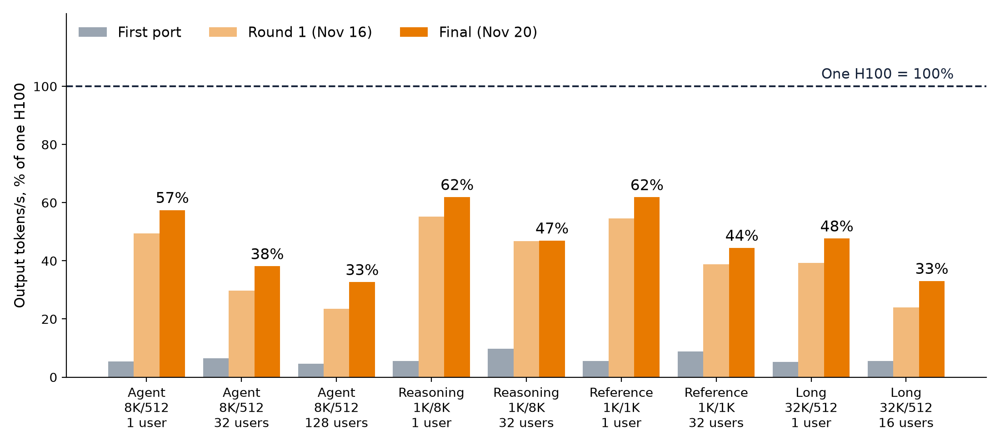
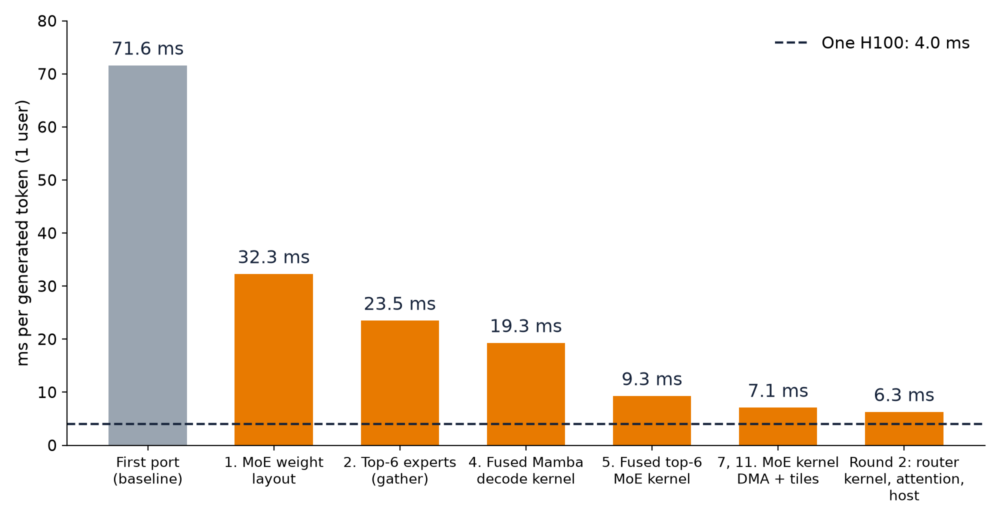
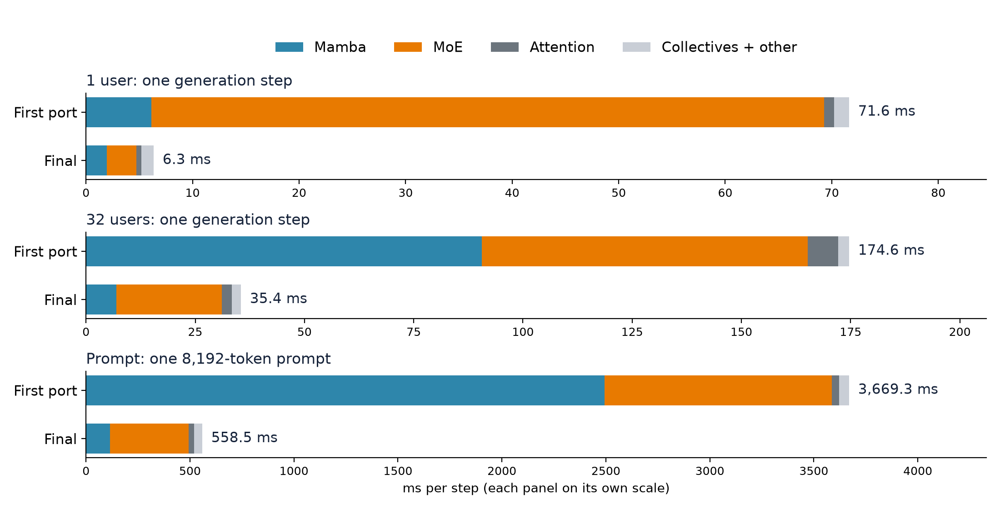
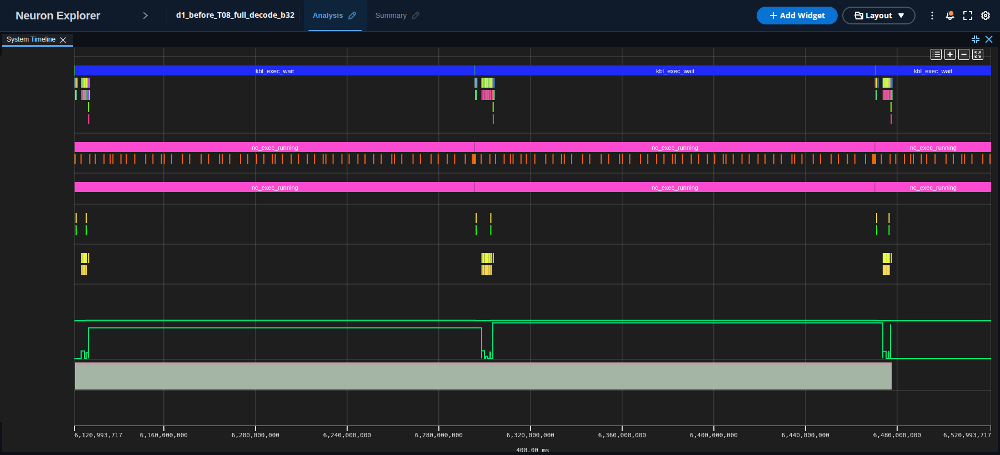
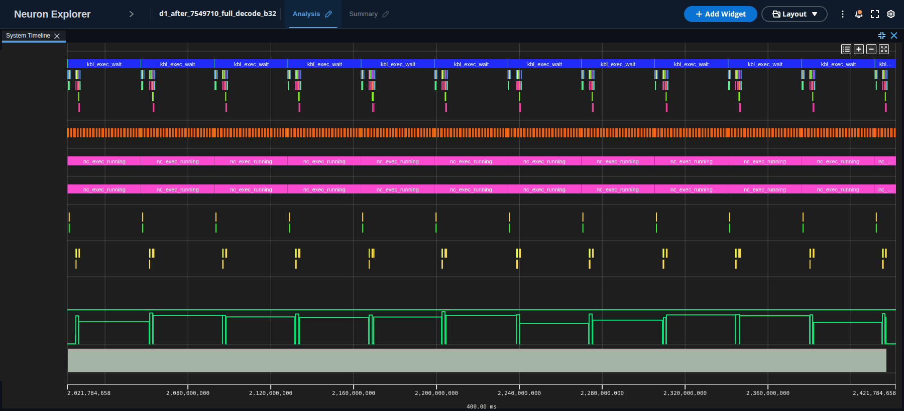

# Nemotron 3.5 Lightning 30B-A3B on Trainium2 with vLLM + vllm-neuron (Neuron SDK 2.33), compared with an H100

- **What:** [NVIDIA Nemotron 3.5 Lightning 30B-A3B](https://huggingface.co/nvidia/NVIDIA-Nemotron-3.5-Lightning-30B-A3B-BF16),
  a hybrid Mamba-2 / mixture-of-experts / attention model that Trainium2's vLLM stack did not support, ported to vLLM Neuron
  on the native PyTorch backend (no NxD Inference), with six custom NKI kernels.
- **Result:** the same accuracy as an H100, 5x to 11x faster than the first working port, 33 % to 62 % of one H100's
  throughput per chip, and 84 % to 98 % of the H100's output tokens per dollar for a whole server.
- **How:** run as an unattended loop of AI coding agents on Trainium2 Capacity Blocks, directed and reviewed by me
  ([How this was done](#how-this-was-done)).

The DLAMI's stock vllm-neuron (0.29.0.1.2.0) has no Neuron implementation of `NemotronHForCausalLM` and no
per-request recurrent state, so engine start fails with
`type object 'NemotronHForCausalLM' has no attribute 'from_configs'`. This guide installs one public branch on top of
the DLAMI's vLLM environment:

| Branch | What it is |
|---|---|
| [battaglia-michael/vllm-neuron@contrib/nemotron-h-0.29](https://github.com/battaglia-michael/vllm-neuron/tree/contrib/nemotron-h-0.29) | vllm-neuron 0.29.0.1.2.0 plus the recurrent-state runner from [PR #68](https://github.com/vllm-project/vllm-neuron/pull/68) (Qwen3.5) and `contrib/models/nemotron_h`: the model, six NKI kernels and small runner changes |

The branch's [model README](https://github.com/battaglia-michael/vllm-neuron/blob/contrib/nemotron-h-0.29/contrib/models/nemotron_h/README.md)
has the usage and tests, and [src/README.md](https://github.com/battaglia-michael/vllm-neuron/blob/contrib/nemotron-h-0.29/contrib/models/nemotron_h/src/README.md)
the architecture and kernel choices. The commands below are the ones used on the benchmark instances
(2026-11-11 to 2026-11-20); they were not re-run on a fresh instance afterwards.

One Trainium2 device (TP=4, LNC=2) vs one H100 80 GB, BF16, final configuration (tag `best-v2c`):

| Workload | Trainium2 | H100 | Trn2 / H100 |
|---|---|---|---|
| One request, 1,024 in / 1,024 out | 154 tok/s, 6.3 ms per token | 249 tok/s, 3.9 ms | 0.62x |
| One request, 8,192 in / 512 out (agent turn) | 135 tok/s, first token 558 ms | 235 tok/s, 158 ms | 0.57x |
| 32 concurrent, 1,024 / 1,024 | 789 tok/s | 1,775 tok/s | 0.44x |
| 128 concurrent, 8,192 / 512 | 655 tok/s | 2,006 tok/s | 0.33x |
| Whole server, 1,024 / 1,024, output tokens per $ | trn2.48xlarge | p5.48xlarge | 0.98x |
| GSM8K / tool calling / needle to 128K | 94.5 % / 83.0 % / 20 of 20 | 95.0 % / 84.0 % / 20 of 20 | |



## Contents

1. [Launch the instance](#1-launch-the-instance)
2. [Install the branch](#2-install-the-branch-into-the-dlamis-vllm-environment)
3. [Download the model](#3-download-the-model)
4. [Serve it](#4-serve-it)
5. [Check it](#5-check-it)
6. [The H100 side](#6-the-h100-side)
- [Results](#results), [Per instance and per dollar](#per-instance-and-per-dollar), [Accuracy](#accuracy), [FP8 and MTP variants](#fp8-and-mtp-variants)
- [How it got faster](#how-it-got-faster), [Profiles](#profiles-before-and-after), [How this was done](#how-this-was-done), [Troubleshooting](#troubleshooting), [Caveats](#caveats), [References](#references)

## 1. Launch the instance

| Setting | Value |
|---|---|
| Instance type | trn2.48xlarge (16 Trainium2 devices; each server uses one device = 4 logical NeuronCores at LNC=2) |
| AMI name | Deep Learning AMI Neuron (Ubuntu 24.04) SDK 2.33.0 20261020 (us-east-2: `ami-02eaa082292ed0cf9`) |
| Neuron SDK | 2.33 |
| Disk | 1 TB gp3 root; the instance-store NVMe (RAID0) for the model and compile caches |

trn2 instances need a Capacity Block. Any other region:

```bash
aws ec2 describe-images --owners amazon --region <REGION> \
  --filters "Name=name,Values=Deep Learning AMI Neuron (Ubuntu 24.04) SDK 2.33.0 20261020" \
  --query 'Images[*].[ImageId,Name]' --output table
```

The instance has 2 TiB of RAM, so no swap is needed. The model (63 GB in BF16) fits on one device (96 GB HBM).
A trn2.3xlarge (one device) was not tested; every number here was measured on a trn2.48xlarge.

## 2. Install the branch into the DLAMI's vLLM environment

```bash
export VLLM_VENV=/opt/aws_neuronx_venv_pytorch_inference_vllm_0_29_0_1_2_0
source $VLLM_VENV/bin/activate

git clone -b contrib/nemotron-h-0.29 https://github.com/battaglia-michael/vllm-neuron ~/vllm-neuron
export VLLM_NEURON_DIR=~/vllm-neuron
pip install --no-deps --force-reinstall -e $VLLM_NEURON_DIR                            # vllm-neuron with the recurrent-state runner
pip install --no-deps --force-reinstall -e $VLLM_NEURON_DIR/contrib/models/nemotron_h  # registers NemotronHForCausalLM
```

Check that it took effect:

```bash
python -c "
from importlib.metadata import entry_points
print('nemotron_h plugin:', 'nemotron_h' in [e.name for e in entry_points(group='vllm.general_plugins')])
import vllm_neuron; print(vllm_neuron.__file__)"
# nemotron_h plugin: True
# .../vllm-neuron/vllm_neuron/__init__.py
```

- `--force-reinstall` is required: the branch has the same version number as the DLAMI's plugin (0.29.0.1.2.0).
- `--no-deps` keeps the DLAMI's pinned torch, vllm, transformers and nki.
- The contrib package registers the model through vLLM's `vllm.general_plugins` entry point, so no `PYTHONPATH`
  change is needed.

Versions in the environment after the install:

| Component | Version |
|---|---|
| vllm | 0.29.0 |
| vllm-neuron | 0.29.0.1.2.0 (branch `contrib/nemotron-h-0.29`) |
| vllm-neuron-contrib-nemotron-h | 0.1.0 |
| torch / torch-xla | 2.13.0 |
| transformers | 5.17.0 |
| nki | 0.7.0 |
| neuronx-cc | 2.28.7631.0 |
| aws-neuronx-runtime-lib / tools | 2.35.30.0 / 2.33.38.0 |

No NxD Inference package is installed or used.

## 3. Download the model

The model is not gated.

```bash
export MODEL_DIR=/mnt/nvme/models/NVIDIA-Nemotron-3.5-Lightning-30B-A3B-BF16
hf download nvidia/NVIDIA-Nemotron-3.5-Lightning-30B-A3B-BF16 --local-dir $MODEL_DIR
```

## 4. Serve it

Each server profile in `trn2/profiles/` sets the context length, batch sizes and buckets, then calls
`trn2/serve_nemotron.sh`. The first argument is the NeuronCore range (one device = 4 cores), the second the port.

| Profile | Context | Max requests | Used for |
|---|---|---|---|
| `S.sh` | 8,960 | 128 | 8K / 512 and 1K / 1K rows; the per-instance run |
| `L.sh` | 40,960 | 32 | 1K / 8K reasoning and 32K rows |
| `Ltools.sh` | 40,960 | 32 | L plus the tool-call and reasoning parsers (tool-calling test) |
| `P.sh` | 8,960 | 32 | prefix caching on (shared-prefix row) |
| `XL.sh` | 133,120 | 1 | 128K row |
| `C1.sh` | 40,960 | 1 | one-request latency with the NKI Library `moe_tkg` kernel (separate deployment, not in the headline) |

```bash
source $VLLM_VENV/bin/activate
export MODEL_DIR VLLM_VENV VLLM_NEURON_DIR
trn2/profiles/S.sh 0-3 8000          # device 0; run in tmux
```

For profile S this runs (the script prints it):

```bash
export NEURON_VISIBLE_DEVICES=0-3 NEURON_SKIP_EFA_AFFINITY=1 VLLM_NEURON_BACKEND=neuron_native
export VLLM_NEURON_KV_GMU_BUDGET_CAP_FRACTION=0.25 NEURON_RT_EXEC_TIMEOUT=300
taskset -c <the device's NUMA-node CPUs> vllm serve $MODEL_DIR --served-model-name nemotron \
  --host 127.0.0.1 --port 8000 --tensor-parallel-size 4 --dtype bfloat16 \
  --max-model-len 8960 --max-num-seqs 128 --max-num-batched-tokens 4096 --no-enable-prefix-caching \
  --additional-config '{"neuron_config": {"num_batched_tokens_buckets": [2048, 4096],
     "kv_segment_size_buckets": [4096], "num_seqs_buckets": [1, 8, 32, 128],
     "on_device_sampling_config": {"all_greedy": false}}}'
```

The first start compiles the graphs: 5 to 22 minutes with a warm cache, longer from empty. The server is ready
when the log shows `Application startup complete`.

```bash
curl -s localhost:8000/v1/chat/completions -H 'Content-Type: application/json' -d '{
  "model": "nemotron", "max_tokens": 32, "temperature": 0,
  "messages": [{"role": "user", "content": "What is the capital of France? Answer in one sentence."}],
  "chat_template_kwargs": {"enable_thinking": false}}' | python -m json.tool
```

| Setting | Why |
|---|---|
| `NEURON_VISIBLE_DEVICES=0-3` | Picks the device by core ids (`NEURON_RT_VISIBLE_CORES` is rejected by vLLM's multi-process mode). |
| `NEURON_SKIP_EFA_AFFINITY=1` | Without EFA interfaces, engine start fails with `No EFA device found`. |
| `VLLM_NEURON_KV_GMU_BUDGET_CAP_FRACTION=0.25` | The scheduler admits at most `kv_cache_tokens // max_model_len` requests; 0.25 fits 128 x 8,960 tokens and leaves HBM for the graphs. |
| `NEURON_RT_EXEC_TIMEOUT=300` | The default 30 s timeout killed the engine (`NRT_TIMEOUT`) while the host was compiling other servers. |
| `--max-num-batched-tokens 4096`, buckets `[2048, 4096]` | 4,096-token prefill chunks; the 2,048 bucket keeps short prompts from padding to 4,096. |
| No `decode_context_length_buckets` on S | With them, profile S's graphs did not fit in HBM (`Allocation Failure`). |
| `taskset` to the device's NUMA node | 1-2 % lower time per token at one request. |
| `VLLM_CACHE_ROOT` per model source and `NEMOTRON_H_*` env | vLLM's compile cache ignores both and would restore stale graphs. |

Every kernel can be switched off with a `NEMOTRON_H_*` variable (the model README lists them); all results use the
defaults.

## 5. Check it

The harness is in `bench/`; GSM8K and the BFCL subset are in `bench/data/`. Run it
against the server from step 4. The teacher-forced and chunked-prefill checks need reference labels from Hugging Face
transformers, made once on the CPU (a few hours on this instance), with the Mamba step size not clamped
(`--dt-limit none`, see [Accuracy](#accuracy)):

```bash
R=results/references-dtnone
python bench/accuracy/make_refs_nemotron.py build --model $MODEL_DIR --out $R
python bench/accuracy/make_refs_nemotron.py label --model $MODEL_DIR --out $R --dtype fp32 --dt-limit none --threads 48
python bench/accuracy/make_refs_nemotron.py label --model $MODEL_DIR --out $R --dtype bf16 --dt-limit none --threads 48
python bench/accuracy/make_refs_nemotron.py merge --out $R
```

Then, against the server:

```bash
python bench/accuracy/teacher_forced.py  --model nemotron --refs results/references-dtnone --max-seq-len 8192
python bench/accuracy/batch_invariance.py --model nemotron
python bench/accuracy/chunked_prefill.py --model nemotron --refs results/references-dtnone --max-num-batched-tokens 4096
python bench/accuracy/gsm8k.py   --model nemotron
python bench/accuracy/toolcall.py --model nemotron      # server from trn2/profiles/Ltools.sh
python bench/accuracy/needle.py  --model nemotron --tokenizer $MODEL_DIR --max-model-len 40960
python bench/run_matrix.py --platform trn2 --port 8000 --model nemotron --tokenizer $MODEL_DIR \
  --max-model-len 8960 --out-dir results/trn2/mine --rows agent_8k,ref_1k_1k
```

Each benchmark row is `vllm bench serve --dataset-name random --ignore-eos --temperature 1.0 --top-p 0.95` with a fixed
seed per row, so both platforms get the same prompts. `python bench/run_matrix.py --list` shows the rows.

## 6. The H100 side

One H100 80 GB of a p5.48xlarge, `Deep Learning Base OSS Nvidia Driver GPU AMI (Ubuntu 24.04)`, Docker image
`vllm/vllm-openai:v0.27.1` (the version in NVIDIA's model card), with the model card's single-H100 recipe:

```bash
vllm serve --model $MODEL_DIR --served-model-name nemotron --host 127.0.0.1 --port 8000 --max-num-seqs 128 \
  --enable-prefix-caching --async-scheduling --mamba-backend flashinfer --mamba-ssm-cache-dtype float16 \
  --enable-mamba-cache-stochastic-rounding --mamba-cache-philox-rounds 5
```

The same harness ran against it. `h100/run_all.sh` (one GPU) and `h100/run_round2.sh` (all 8 GPUs, FP8, MTP,
chunked prefill) run everything unattended from EC2 user data and upload results to an S3 bucket you pass in
(`h100/README.md`).

## Results

One Trainium2 device (TP=4, LNC=2) with the `best-v2c` branch commit and the profiles above, against one H100 with the
recipe above. `vllm bench serve`, random prompts, EOS ignored, temperature 1.0 / top_p 0.95, median (p50) latencies.
Every row completed with 0 failed requests. Time to first token at high concurrency includes queueing.

| Online (input / output) | Concurrency | Trn2 tok/s | Trn2 TTFT p50 | Trn2 TPOT p50 | H100 tok/s | H100 TTFT p50 | H100 TPOT p50 | Trn2 / H100 |
|---|---|---|---|---|---|---|---|---|
| 8,192 / 512 (agent turn) | 1 | 135 | 558 ms | 6.3 ms | 235 | 158 ms | 4.0 ms | 0.57x |
| 8,192 / 512 | 32 | 468 | 8.7 s | 51.4 ms | 1,228 | 711 ms | 24.3 ms | 0.38x |
| 8,192 / 512 | 128 | 655 | 33.9 s | 129 ms | 2,006 | 890 ms | 59.5 ms | 0.33x |
| 1,024 / 8,192 (reasoning) | 1 | 156 | 179 ms | 6.4 ms | 252 | 86 ms | 4.0 ms | 0.62x |
| 1,024 / 8,192 | 32 | 891 | 2.8 s | 35.6 ms | 1,898 | 497 ms | 16.8 ms | 0.47x |
| 1,024 / 1,024 | 1 | 154 | 178 ms | 6.3 ms | 249 | 75 ms | 3.9 ms | 0.62x |
| 1,024 / 1,024 | 32 | 789 | 2.8 s | 37.9 ms | 1,775 | 395 ms | 17.7 ms | 0.44x |
| 32,768 / 512 (long session) | 1 | 89.6 | 2.35 s | 6.6 ms | 188 | 687 ms | 4.0 ms | 0.48x |
| 32,768 / 512 | 16 | 165 | 19.1 s | 59.8 ms | 499 | 1.72 s | 28.2 ms | 0.33x |
| 131,072 / 512 (long document) | 1 | 27.2 | 14.7 s | 8.1 ms | 88.1 | 3.74 s | 4.1 ms | 0.31x |
| 8,192 / 512, shared 6,144-token prefix, prefix caching on | 32 | 685 | 3.1 s | 40.8 ms | 1,601 | 627 ms | 18.6 ms | 0.43x |

The first working port (tag `baseline-v1`) did 12.7 tok/s at 71.6 ms per token on the first row. Round 1 ended at tag
`best-v1` (116 tok/s, 7.1 ms).

### Per instance and per dollar

One server per device or GPU, 32 requests in flight on each, all started together, no load balancer. Both sides
measured with every server running at once.

| Workload | trn2.48xlarge (13 of 16 devices measured) | p5.48xlarge (8 GPUs) | Throughput Trn2 / H100 | Output tokens per $ Trn2 / H100 |
|---|---|---|---|---|
| 8,192 / 512 | 6,071 tok/s | 9,705 tok/s | 0.63x | 0.84x |
| 1,024 / 1,024 | 10,242 tok/s | 13,985 tok/s | 0.73x | 0.98x |

- Prices: EC2 Capacity Block rates paid in November 2026 (us-east-2): trn2.48xlarge $35.76/h, p5.48xlarge $47.76/h.
  Trainium2 has no on-demand price in US regions; p5.48xlarge on-demand is $55.04/h.
- Trainium2 is charged for all 16 devices, though 3 were busy with other experiments. Each device matched a single
  device running alone, so all 16 would give an estimated 1.03x and 1.20x the H100's tokens per $.

### Accuracy

| Test | Trainium2 | H100 |
|---|---|---|
| Teacher-forced greedy tokens vs HF FP32, 900 positions up to 8K (pass = within 1 point of HF's own BF16) | 98.44 % (pass) | 98.34 % (pass) |
| Batch invariance (same prompt alone vs in a batch of 32) | pass | fail by the strict rule (BF16 near-ties) |
| Chunked prefill vs HF labels | pass | pass (4,096-token chunks) |
| GSM8K, 1,319 questions, zero-shot CoT, thinking off (95 % CI ±1.2 points) | 94.47 % | 95.00 % |
| Tool calling, BFCL simple + multiple, 200 items | 83.0 % | 84.0 % |
| Needle retrieval at 1K / 16K / 32K / 128K | 5 / 5 at each | 5 / 5 at each |

The differences are within noise. Every kept optimization re-ran the first three checks first. The Mamba step size
is not clamped, as in NVIDIA's code and vLLM on GPU (see the model README).

### FP8 and MTP variants

Both were tested as separate opt-in variants; neither is in the tables above.

| Variant | Trainium2 | H100 |
|---|---|---|
| FP8 weights | -2 % to +14 % vs BF16; passes the accuracy gate | +4 % to +16 %; token match 96.7 %, fails the gate |
| MTP speculative decoding, 1 draft token | outputs differ from normal decoding; the exact version was slower; not adopted | -7 % to +20 % by row; GSM8K unchanged |


## How it got faster

Each step was found from a profile (Neuron profiler / Neuron Explorer), developed on spare devices, measured on a clean
device in same-session before/after pairs, and kept only if it was faster and passed the accuracy gate. The step
numbers and IDs (`T12`, `R2-03`) also appear in the branch's code comments.



| Step | Change | Effect on one device |
|---|---|---|
| 1 | Store the stacked MoE up weight in the layout the matrix engine reads (no per-step transpose of 319 MB) | 1 request: 71.6 → 32.3 ms per token |
| 2 | Top-6 experts only at batch 1 (small NKI gather kernel) | 32.3 → 23.5 ms |
| 3 | Mamba prefill input projection as three matmuls on weight slices | prefill chunk 897 → 330 ms |
| 4 | **NKI kernel: fused Mamba-2 decode step** (`mamba_decode.py`) | 32 requests: +64 % to +209 % tok/s |
| 5, 7, 11 | **NKI kernel: fused top-6 MoE decode at batch 1** (`moe_topk.py`), then its DMA queues and tile size | 19.3 → 7.1 ms per token |
| 8, 12, 13 | **NKI kernel: routed MoE prefill** (`moe_prefill.py`) | prefill chunk 330 → 216 ms |
| 14, 15, 17 | Aligned Mamba state pages, 4,096-token prefill chunks, NUMA pinning | -2 % to -10 % |
| R2-A | **NKI kernel: routed MoE decode for 8-16 requests** (`moe_decode_routed.py`) | MoE -23 % to -35 % per step at 8-16 |
| R2-B | Decode attention block table padded to a 1,024-token multiple | 32 requests: step 40.0 → 35.4 ms; 128: 82.8 → 63.9 ms |
| R2-C, C2, C5 | **NKI kernel: fused Mamba-2 prefill** (`ssd_prefill.py`) with an NKI input projection, plus MoE prefill tile prefetch | TTFT -15 % to -20 %, then -6 % on long prompts |
| R2-D | **NKI kernel: batch-1 router** (`router_top8.py`), expert loads issued first | device step 6.75 → 6.34 ms |
| R2-G | Host-side cache of per-step decode inputs | late steps 7.7 % → 0.07 % |
| R2-C4 | Prefix caching with the fused Mamba prefill kernel | shared-prefix TTFT -17 % |

Measured and dropped: a split Mamba decode (41-52 % slower), an all-in-one MoE decode kernel, routed MoE decode at
32-128 requests, NKI matmuls in the decode graph, and moving the MoE prefill transposes off the matrix engine.

Where the gap is now: one request takes 6.3 ms per token against a hardware floor of about 2.8 ms, and prefill MoE,
two-thirds of time to first token, is limited by data movement rather than math.

## Profiles, before and after

Full 52-layer model on one device, from live system traces (Neuron profiler), split at the collectives between layers:



The same 400 ms of a server handling 32 requests in Neuron Explorer, first port vs final, at the same time scale. Each
blue block on the top row is one generation step: about 175 ms before, about 35 ms after. Row labels are removed.

| First port | Final |
|---|---|
|  |  |

## How this was done

I ran this as an unattended loop of AI coding agents (Kiro, with AWS's Neuron agentic development agents and skills
for NKI kernels, vLLM Neuron porting and profiling) on Trainium2 Capacity Blocks, over about nine days. Each task ran
from a queue with a time limit and a required result file, and no change was kept unless it passed the accuracy gate.

- **The agents** wrote the port, the NKI kernels and the benchmark harness, and ran the profiles and measurements.
- **I** set the goal and the ground rules (native PyTorch backend, no NxD Inference, a fair H100 baseline on NVIDIA's
  own recipe, workloads based on agent, chat and reasoning use, the accuracy gate), decided what each round would try,
  and managed the budget. I reviewed the code and the profiles to understand each change, made a few small code
  changes, and redirected the work when results looked wrong or went off course.

## Troubleshooting

| Symptom | Fix |
|---|---|
| `type object 'NemotronHForCausalLM' has no attribute 'from_configs'` | The stock vllm-neuron is still installed. Reinstall with `--force-reinstall` (step 2). |
| `NEURON_RT_VISIBLE_CORES cannot be used with multi-processing execution on vLLM` | Unset it; use `NEURON_VISIBLE_DEVICES=<core range>`. |
| `No EFA device found at /sys/bus/pci/devices/...` | `export NEURON_SKIP_EFA_AFFINITY=1`. |
| `Could not load the model status=4 message=Allocation Failure` after the graphs compiled | Out of HBM at load: fewer graphs (drop `decode_context_length_buckets`) or a lower `VLLM_NEURON_KV_GMU_BUDGET_CAP_FRACTION`. |
| Server stays at e.g. `Running: 123 reqs, Waiting: 5 reqs` with low KV usage | The scheduler admits at most `kv_cache_tokens // max_model_len` requests. Raise the KV cap or lower `--max-model-len`. |
| `missing collectives status ... NRT_TIMEOUT`, then `EngineDeadError`, under heavy host load | `export NEURON_RT_EXEC_TIMEOUT=300`. |
| A code or `NEMOTRON_H_*` change has no effect, or `ModuleNotFoundError` for a kernel module at load | Stale torch.compile cache: use a fresh `VLLM_CACHE_ROOT` (the serve script keys it by source and env). |
| Engine start is very slow the first time | Expected: the cold compile. Later starts use `~/.cache/neuron_libtorch`. |


## Caveats

- One run per cell in the result tables (host jitter is about 1-3 % at one request); random-token prompts.
- vLLM 0.27.1 on the H100 (NVIDIA's recipe) vs 0.29.0 on Trainium2 (pinned by Neuron SDK 2.33).
- The H100 recipe keeps the Mamba state in FP16 and turns on prefix caching; the Trainium2 headline uses FP32 state and
  no prefix caching.
- The port depends on an unmerged community branch (PR #68); upstreaming it is proposed in
  [vllm-project/vllm-neuron#132](https://github.com/vllm-project/vllm-neuron/issues/132).

## References

- Model: https://huggingface.co/nvidia/NVIDIA-Nemotron-3.5-Lightning-30B-A3B-BF16 (license on the model card)
- vllm-neuron branch: https://github.com/battaglia-michael/vllm-neuron/tree/contrib/nemotron-h-0.29
- Recurrent-state runner: [vllm-project/vllm-neuron PR #68](https://github.com/vllm-project/vllm-neuron/pull/68)
  (whn09 and gregnetau), branch https://github.com/whn09/vllm-neuron/tree/contrib-qwen3-5
- vLLM Neuron documentation: https://awsdocs-neuron.readthedocs-hosted.com/en/latest/vllm-neuron/
- NKI documentation: https://awsdocs-neuron.readthedocs-hosted.com/en/latest/nki/
- Format of this writeup: [jimburtoft/neuronstuff](https://github.com/jimburtoft/neuronstuff), e.g. mistral-7b-vllm-neuron

## License

Code and scripts in this folder: Apache-2.0 (see [`LICENSE`](../LICENSE)). The model weights are not included and are under NVIDIA's
license for the model. `bench/data/gsm8k_test.jsonl` is the GSM8K test split (openai/grade-school-math, MIT);
`bench/data/bfcl_subset.jsonl` is a sample of the Berkeley Function Calling Leaderboard v3 (Apache-2.0).
